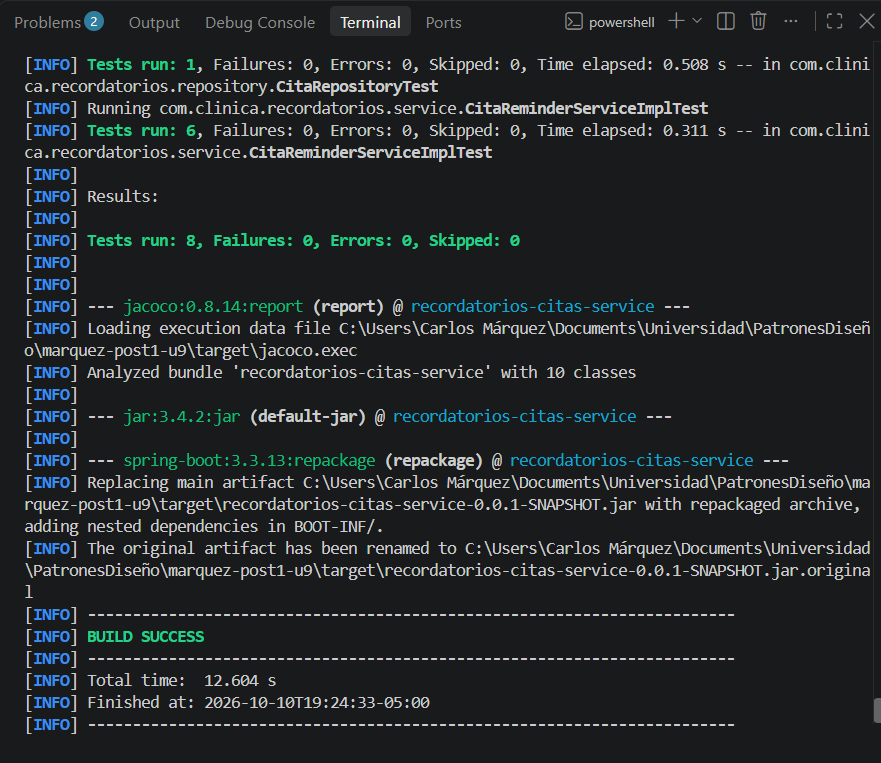
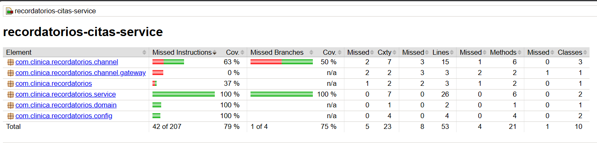
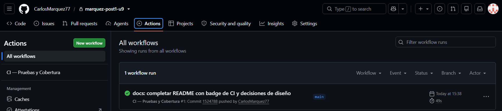

# Recordatorios Citas Service


## Descripción
Repositorio del post-contenido de la Unidad 9 de Patrones de Diseño
de Software — Sexto Semestre. Un único proyecto Spring Boot que
envía recordatorios de citas por el canal preferido del paciente
(correo o SMS), construido desde el inicio con Strategy
(ReminderChannel) y Factory Method (ReminderChannelFactory)
inyectados por constructor.

## Parte 1 — Pruebas Unitarias con JUnit 5 y Mockito
CitaReminderServiceImplTest aísla CitaReminderServiceImpl de sus
tres colaboradores (CitaRepository, ReminderChannelFactory y Clock)
sin levantar el contexto de Spring. Ver "Decisiones de diseño" para
la justificación de por qué cada uno se mockeó, se stubeó o se
resolvió con un fake.

## Parte 2 — Refactor DIP, Integración y CI/CD
enviarRecordatorioUrgente nació con un "new" hardcodeado que lo
hacía imposible de testear; el refactor lo movió a
config/CanalUrgenteConfig.java e inyectó la abstracción por
constructor. CitaRepositoryTest (@DataJpaTest) y
CitaReminderServiceIntegrationTest (@SpringBootTest) prueban la
persistencia y el flujo completo con H2 y un Clock fijo. El pipeline
.github/workflows/ci.yml ejecuta mvn verify en cada push.

## Decisiones de diseño

### Por qué Strategy facilitó las pruebas
`ReminderChannel` deja todo el envío detrás de un solo método,
`enviar(Cita, String)`. Gracias a eso,
`enviarRecordatoriosPendientes_citaEnVentana_usaElCanalPreferido`
comprueba el envío con un único `@Mock ReminderChannel` y un
`verify(reminderChannelMock, times(1)).enviar(eq(cita), anyString())`,
y la misma prueba serviría para SMS o para un canal nuevo sin cambiar
nada más que el enum.

*Sin el patrón:* el código de correo y de SMS estaría escrito dentro
del `for` del servicio. Para probar que se envió algo habría que
mockear las librerías de bajo nivel de cada canal (el cliente SMTP y
el cliente HTTP del proveedor de SMS), que tienen muchos más métodos
que `enviar`, y cada canal nuevo obligaría a tocar el servicio y
todas sus pruebas.

### Por qué Factory facilitó las pruebas
Con `ReminderChannelFactory` inyectada, la decisión de qué canal usar
es una llamada que se puede observar. La prueba le dice al mock
`when(reminderChannelFactory.obtenerCanal(CanalNotificacion.EMAIL)).thenReturn(reminderChannelMock)`
y así controla qué canal recibe el servicio; y
`enviarRecordatoriosPendientes_sinCitasPendientes_noConsultaLaFactory`
puede afirmar con `verifyNoInteractions(reminderChannelFactory)` que
no se pidió ningún canal cuando no había citas.

*Sin el patrón:* el `switch` de `ReminderChannelFactoryImpl` estaría
dentro del servicio y devolvería directamente `EmailReminderChannel` o
`SmsReminderChannel`. La selección solo se podría comprobar de forma
indirecta, mirando qué se imprimió o qué se envió de verdad, y no
habría manera de entregarle al servicio un canal de prueba.

### Mock vs. Stub vs. Fake (Parte 1)

| Colaborador | Test Double | Qué necesita la prueba de él |
|-------------|-------------|------------------------------|
| CitaRepository | Mock | Controlar la lista que devuelve y verificar `save()` |
| ReminderChannelFactory / ReminderChannel | Mock | Verificar qué canal se pidió y que recibió el mensaje |
| Clock | Fake (`Clock.fixed`) | Una hora fija y real para que la ventana de 24 horas sea exacta |

**CitaRepository → Mock.** La prueba necesita dos cosas del
repositorio: que `findByFechaHoraCitaBetweenAndRecordatorioEnviadoFalse`
devuelva la lista de citas que yo decida, y comprobar que después se
llamó `save(cita)` una sola vez con la cita ya marcada como enviada.
Lo primero lo resuelve un Stub, pero lo segundo no: si el servicio
dejara de guardar la cita, un Stub no lo notaría y el paciente
recibiría el mismo recordatorio en cada ejecución. Como hay que
controlar la respuesta y además verificar la interacción, es un Mock.
*Por qué no un Fake:* un repositorio en memoria serviría si la prueba
guardara y luego consultara, pero aquí basta una respuesta fija por
escenario y habría que mantener una clase extra.

**ReminderChannelFactory y ReminderChannel → Mock.** Lo que se prueba
es la selección de la estrategia: que para una cita con canal EMAIL el
servicio pida `obtenerCanal(EMAIL)` y que el canal devuelto reciba
`enviar(cita, mensaje)`. `enviar` es `void`, así que no hay un valor
de retorno que revisar; la única forma de comprobarlo es verificando
la interacción. *Por qué no un Stub:* un Stub de la Factory devolvería
el canal, pero no permitiría comprobar que el canal se usó ni el caso
contrario de la tercera prueba, cuando no hay citas pendientes.

**Clock → Fake, no Mock.** `Clock.fixed(Instant.parse("2026-08-10T09:00:00Z"), ZoneId.of("UTC"))`
es una implementación real de `java.time.Clock` que trae el JDK, solo
que con el instante congelado. Con ella, `LocalDateTime.now(clock)`
funciona igual que en producción y la prueba
`enviarRecordatoriosPendientes_ventanaDeterministaSegunClockFijo_consultaLosLimitesExactos`
puede afirmar los límites exactos de la consulta (10 de agosto 09:00 a
11 de agosto 09:00). *Por qué no un Mock:* habría que stubear
`instant()` y `getZone()` por separado, y si faltara uno,
`LocalDateTime.now(clock)` fallaría con un error que no tiene que ver
con el servicio. Además no interesa verificar cuántas veces se leyó el
reloj, solo que la hora sea conocida.

### El refactor DIP (Parte 2)

**Diagnóstico antes del refactor.** `enviarRecordatorioUrgente(Long citaId)`
funcionaba al ejecutarlo, pero no se podía probar de forma aislada. La
línea responsable era la 52 de `CitaReminderServiceImpl.java` en el
commit `feat(service): agregar enviarRecordatorioUrgente con new hardcodeado (a refactorizar)`:

```java
ReminderChannel canalUrgente = new SmsReminderChannel(new TwilioNotificadorSmsGateway());
```

El canal y el gateway se construían con `new` dentro del método, así
que la prueba no tenía por dónde entregarle al servicio un canal
distinto. El escenario que más interesa, "el gateway de SMS falla y
la cita no debe quedar marcada como enviada", era imposible de
escribir. En cambio `enviarRecordatoriosPendientes()` sí era testeable
desde la Parte 1 porque su canal sale de
`reminderChannelFactory.obtenerCanal(...)`, y la Factory llega por el
constructor. `Mockito.mockConstruction()` podría interceptar ese
`new`, pero sería arreglar con la herramienta de pruebas un problema
que es del diseño.

**Antes** (dentro del servicio):

```java
@Override
public void enviarRecordatorioUrgente(Long citaId) {
    Cita cita = citaRepository.findById(citaId)
        .orElseThrow(() -> new CitaNoEncontradaException(citaId));

    ReminderChannel canalUrgente = new SmsReminderChannel(new TwilioNotificadorSmsGateway());
    canalUrgente.enviar(cita, "URGENTE: su cita es en menos de 2 horas y no ha sido confirmada");

    cita.setRecordatorioEnviado(true);
    citaRepository.save(cita);
}
```

**Después** (el `new` vive en `config/CanalUrgenteConfig.java` y el
servicio recibe la abstracción):

```java
@Bean
public ReminderChannel canalUrgente(NotificadorSmsGateway gateway) {
    return new SmsReminderChannel(gateway);
}
```

```java
public CitaReminderServiceImpl(CitaRepository citaRepository,
                                ReminderChannelFactory reminderChannelFactory,
                                @Qualifier("canalUrgente") ReminderChannel canalUrgente,
                                Clock clock) { ... }

@Override
public void enviarRecordatorioUrgente(Long citaId) {
    Cita cita = citaRepository.findById(citaId)
        .orElseThrow(() -> new CitaNoEncontradaException(citaId));

    canalUrgente.enviar(cita, "URGENTE: su cita es en menos de 2 horas y no ha sido confirmada");
    cita.setRecordatorioEnviado(true);
    citaRepository.save(cita);
}
```

El comportamiento externo es el mismo: el recordatorio urgente sigue
saliendo por SMS. Lo que cambió es que ahora la prueba pasa un
`@Mock ReminderChannel canalUrgenteMock` por el constructor.
`enviarRecordatorioUrgente_gatewayFalla_noMarcaComoEnviado` hace que
ese mock lance una excepción con `doThrow(...)` y comprueba
`verify(citaRepository, never()).save(any())`. Esa prueba no se podía
escribir antes del refactor, y por eso es la evidencia de que la
testabilidad salió de aplicar DIP y no de la herramienta.

*Alternativa descartada:* dejar el `new` y agregar un setter solo para
pruebas. Se descartó porque el servicio seguiría dependiendo de
`TwilioNotificadorSmsGateway` en producción y quedaría un método
público que solo existe para las pruebas.

**H2 real pero gateway mockeado.** En
`CitaReminderServiceIntegrationTest` conviven una base H2 real y un
`@MockBean NotificadorSmsGateway`. H2 es un fake aceptable porque
ejecuta de verdad el SQL que genera JPA, sin instalar nada. Para un
proveedor de SMS no existe un equivalente gratuito y determinista, así
que usar el real haría depender cada ejecución de credenciales, de la
red y de que el proveedor esté disponible.

**CI sin contenedor de base de datos.** `ci.yml` no tiene bloque
`services:` porque las pruebas de integración usan H2 en memoria. Con
PostgreSQL y Testcontainers el runner necesitaría Docker y el pipeline
tardaría más en arrancar.

**Ajuste al código de la guía.** En `CitaReminderServiceIntegrationTest`
el bean de prueba se llama `clockFijo()` y no `clock()`. Con el mismo
nombre que el bean de `ClockConfig`, Spring Boot 3.3 no levanta el
contexto (`BeanDefinitionOverrideException`, porque la sobrescritura
de beans viene desactivada). Con otro nombre y `@Primary`, el servicio
recibe el reloj fijo sin activar esa opción.

## Ejecutar las pruebas
```bash
mvn test                  # Pruebas unitarias
mvn verify                # Unitarias + integración
```

El reporte de cobertura de JaCoCo queda en `target/site/jacoco/index.html`.

## Evidencia de pruebas
Las 8 pruebas en verde (6 unitarias, 1 `@DataJpaTest` y 1 `@SpringBootTest`):



Reporte de cobertura de JaCoCo. `CitaReminderServiceImpl` queda con
100 % de líneas y de ramas; el total del proyecto es 84,9 % de líneas,
porque `TwilioNotificadorSmsGateway` se reemplaza por un mock y el
`main` no se ejecuta en las pruebas:



Workflow de GitHub Actions con estado Success:



## Herramientas utilizadas
- Java 21, Spring Boot 3.3, Spring Data JPA, H2, JUnit 5, Mockito, JaCoCo
- Apache Maven, GitHub Actions, Git, GitHub

## Conclusiones
Lo que más me quedó de este laboratorio es que una clase se puede
probar o no desde que se diseña, no cuando se escribe la prueba. El
servicio se pudo aislar con tres dobles sencillos porque Strategy y
Factory ya dejaban sus dependencias detrás de interfaces que llegan
por el constructor. Elegir el doble también fue una decisión: mock
donde había que verificar una interacción y un fake del JDK para el
reloj, que resultó más simple y más fiel que mockearlo. En la Parte 2
vi el caso contrario, un solo `new` dentro del método bastó para que
el escenario de fallo no se pudiera probar, y moverlo a la
configuración lo resolvió sin cambiar lo que hace el método. Con H2 y
el gateway mockeado las pruebas de integración corren igual en mi
equipo y en GitHub Actions, sin infraestructura adicional.
